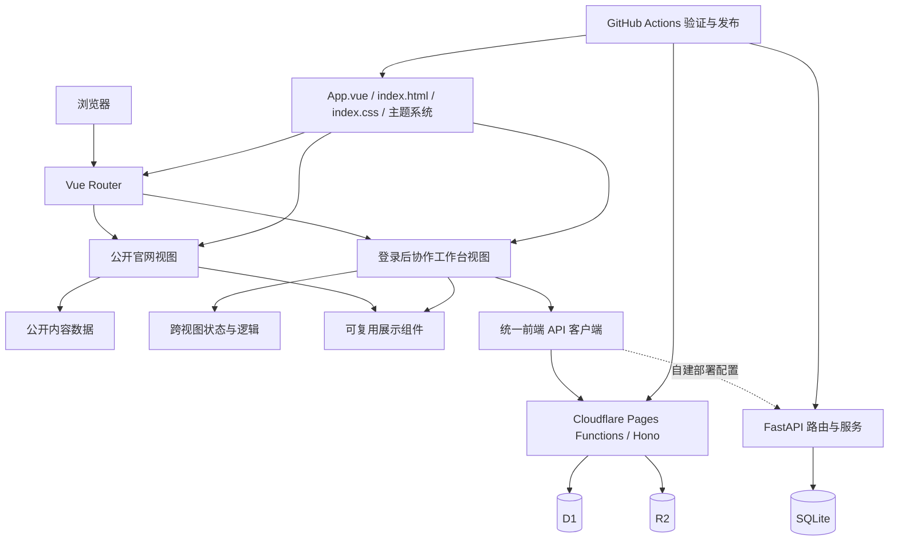

# 模块边界、依赖关系与并行开发责任图

> 文档类型：工程架构地图（基于代码目录和入口静态审查）。
> 审查基准：`main` SHA `7b30644199310c82f769079eb65ada615c0a5c0b`。
> 适用范围：课题组公开官网、登录后的协作工作台、Cloudflare 托管 API、自建 FastAPI 模式及其 CI。
> 证据边界：此文描述代码结构与开发协作规则，不等于对所有页面、API 或生产行为完成了运行时验收。

## 1. 先给结论

项目已经具备基本模块化：页面位于 `views/`，可复用组件位于 `components/`，跨页面状态与逻辑位于 `composables/`，Cloudflare API 按业务域拆分，FastAPI 也按路由与服务拆分。因此，**不需要推倒重写，也不应把所有功能拆成大量微型文件**。

当前并行开发的主要风险来自“共享热点”和“多个后端实现”，而非所有功能都互相依赖：

1. 全局壳层、全局 CSS、主题状态和浏览器验收脚本会影响多个页面。
2. 公开官网与登录后的协作工作台共享一部分应用入口和样式变量，但权限、主题和数据边界不同。
3. Cloudflare Pages Functions + D1/R2 与 FastAPI + SQLite 是两条实现路径；相同业务在两端不能仅凭目录名称推断行为完全一致。
4. 研究专题内容、主题系统、浏览器烟测在当前多个开放 PR 中出现实际文件重叠；不同会话并不自动形成 Git 隔离。
5. 适合并行的最小单位应是“有明确文件范围、接口契约、测试和验收标准的任务”，而不是越小越好。

## 2. 系统依赖总览

图中的连接表达逻辑依赖，不代表所有部署模式会在一次运行中同时启用。尤其是托管 API 与 FastAPI 必须分别验证。

## 3. 模块分区与建议责任边界

| 分区 | 主要入口和文件 | 可独立承担的典型任务 | 需要协调的共享边界 |
|---|---|---|---|
| 公开官网路由 | `frontend/src/router/index.js`；`PublicHomeView.vue`、`PeopleView.vue`、`EventsView.vue` | 单个公开页面的布局、可访问性、内容展示 | `App.vue`、`index.html`、`index.css`、主题系统、公共导航 |
| 研究专题内容 | `frontend/src/content/researchTopicDetails.js`、`researchTopicDeepGuides.js`、`lab.js`；`ResearchTopicView.vue` | 新增/修订某一专题的内容数据、来源链接和页面内导航 | 专题视图、共享内容 schema、浏览器 smoke；物理结论需要来源和适用条件核查 |
| 学习与计算内容 | `frontend/src/content/learning.js`、`frontend/public/learning/`、`LearningView.vue` | 独立教学条目、公式源文件、可复现小例子 | 学习视图与测试、运行时依赖；不得把未经核查的初稿写成已独立验证 |
| 独立展示组件 | `frontend/src/components/<Component>.vue` 及相应测试 | 新组件或局部交互，不改全局壳层 | 全局 CSS、公共事件、主题 token、移动端行为 |
| 主题与视觉系统 | `frontend/src/composables/useThemeStyle.js`、`frontend/src/views/StyleView.vue`、`PublicThemeSwitcher.vue`、`WorldlineEffects.vue`、`ForecastAtmosphere.vue` | 一条主题/动效任务，由一个主 PR 统一实现和验收 | `index.css`、`App.vue`、`index.html`、首次绘制逻辑、`audit-browser-smoke.mjs` |
| 路由和认证边界 | `frontend/src/router/index.js`、`frontend/src/api/client.js`、`frontend/functions/api/routes/auth.ts`、`backend/auth.py` | 单一认证缺陷或单一路由守卫测试 | token、角色权限、demo 模式、公开路由、双后端授权一致性 |
| Cloudflare 业务 API | `frontend/functions/api/routes/<domain>.ts`、`frontend/functions/api/[[route]].ts`、`types.ts` | 单一业务域的 handler、校验和测试 | 全局路由挂载、Env、认证中间件、D1/R2 schema 和绑定 |
| 自建 FastAPI 业务 API | `backend/routers/`、`backend/services/`、对应 `backend/test_*.py` | 单一业务域的路由、服务和回归测试 | `models.py`、`schemas.py`、`database.py`、`seed.py`、共享鉴权与迁移 |
| 持久化与迁移 | `scripts/schema_d1.sql`、`frontend/wrangler.json`、`backend/models.py`、`backend/migrations.py` | 由单独任务统一处理 schema、迁移和兼容性 | 所有读写同一表的 API；禁止两个 PR 各自改同一表结构 |
| CI 与发布 | `.github/workflows/deploy.yml`、`deploy-pages.yml`、`scripts/verify-cloudflare.mjs` | 单独的 CI/发布治理任务 | 生产权限、环境变量、部署凭据、验证产物与实际发布 SHA |

## 4. 并行开发风险分级

### 绿色：通常适合并行

同时满足以下条件时，可以让不同任务并行开发：

- 只改一个业务域或独立内容文件；
- 不修改共享入口、全局样式、公共类型或数据库结构；
- 有明确的局部测试；
- 任务之间不依赖对方尚未确定的接口。

例如：不同专题的数据条目、相互独立的静态资源、互不重叠的后端业务域测试。若两个任务都改同一个专题数据文件，即使任务含义不同，也不再是绿色。

### 黄色：需要接口约定或顺序安排

包括单一 API 路由加前端调用、共享 composable 的小幅扩展、一个页面与公共导航的联动、双后端同一业务功能。

开始前应确定请求/响应结构、事件名称、样式变量、数据 schema 或依赖 PR。可先并行写不冲突部分，再由一个集成 PR 接入公共入口。

### 红色：同一时刻应指定一个主导 PR

- `frontend/src/index.css`
- `frontend/src/App.vue`
- `frontend/index.html`
- `frontend/src/composables/useThemeStyle.js`
- `frontend/src/components/PublicThemeSwitcher.vue`
- `frontend/src/components/WorldlineEffects.vue`
- `frontend/src/views/StyleView.vue`
- `frontend/tests/audit-browser-smoke.mjs`
- `frontend/src/router/index.js` 中的全局守卫/公开与私有路由策略
- 全局 API 入口、公共认证逻辑、数据库 schema/迁移、生产工作流

“红色”不是禁止修改，而是要求同一时段只有一个明确的主导实现；其他任务通过接口约定、后续 PR 或在基础 PR 合并后 rebase 接续，不能同时重写同一热点。

## 5. 多会话、多 Agent 的实际协作协议

**聊天会话不是 Git 隔离边界；分支才是。** 两个会话若写入同一个分支，仍可能互相覆盖；即使分支不同，只要修改相同文件，也可能在合并时冲突或产生语义回归。

每个任务开始前必须执行：

1. 记录当前 `main` SHA，确认不是从过时基线开工。
2. 列出所有相关开放 PR 的 head SHA 和变更文件。
3. 将本任务计划修改的文件与开放 PR 的文件集合做交集检查。
4. 若存在交集，标记为共享热点：只读审查、等待已有主导 PR，或明确安排先后顺序；不要擅自把代码提交到另一个会话正在使用的分支。
5. 从指定基线创建唯一任务分支，写明任务负责人（会话/Agent）、允许修改路径、禁止修改路径、接口假设与测试要求。
6. PR 开发中可以保持 Draft。功能尚未完成时，CI 失败用于定位问题，不意味着要提前合并，也不应通过删除/跳过有意义的测试来“变绿”。
7. 合并前核对最新 head SHA、相对 main 的 ahead/behind/diverged 状态、文件交集和 CI；更新提交后重新验证新 SHA。
8. 同一功能由多个 PR 共同完成时，明确一个集成 PR；其他 PR 作为依赖、后续增量或明确替代项处理，不要把它们全部连续合并。

## 6. 当前项目的高优先级依赖关系

### 主题与视觉系统

先确定唯一的主题状态/动效实现，再处理全局 CSS 和浏览器验收。涉及主题的多个 PR 不应独立修改 `index.css` 与同一 smoke 脚本后直接合并。优先完成：主题切换契约 → 动效生命周期 → 首次绘制/持久化 → 浏览器测试 → 移动端与减少动态效果验收。

### 研究专题内容

内容数据、页面渲染和导航可以在设计好内容结构后分开，但不能忽略它们的耦合：专题 schema 改变时，必须同步对应视图、单元测试和浏览器验收。每条重要物理结论需有来源、假设/近似、适用范围与未验证标记；视觉或 CI 通过不构成物理正确性证明。

### API、双后端与数据库

优先按业务域并行，公共 API contract、认证中间件和 schema 变更由单独任务协调。对同时支持 Cloudflare 与 FastAPI 的功能，至少核对请求/响应、权限、错误路径和数据可见性；迁移必须可追踪、可重复，并考虑已有数据。

### CI 与发布

当前 `main` 的 `deploy.yml` 已在验证阶段运行前端测试、构建、浏览器 smoke、隔离 Pages 安全检查和完整 FastAPI 测试。当前 main SHA 的 CI 通过不能替代其他 PR HEAD 的 CI。生产发布只能消费经验证的构建产物，并核对发布后的健康与授权检查；本地图形界面或文档说明都不能替代真实部署证据。

## 7. PR 模板应明确的任务契约

每个 PR 至少写明：

- **目标 / 非目标：** 本次具体解决什么，刻意不解决什么。
- **拥有的路径：** 哪些文件由此 PR 主导；哪些共享热点不在本次范围。
- **依赖：** 依赖哪个 PR/接口/schema；是否有其他开放 PR 修改相同文件。
- **契约：** API、props/events、CSS tokens、数据字段或迁移语义有无改变。
- **验证：** 命令、结果、对应 HEAD SHA；浏览器截图/日志/Artifact 在哪里。
- **残余风险：** 未测的路径、移动端/无障碍/减少动态效果、双后端差异等。
- **回滚：** 若出现回归，如何撤销而不损坏用户数据或生产服务。

## 8. 逐步实施顺序

1. 先执行本文件第 5 节的跨会话文件交集检查，收敛现有共享热点 PR 的主导关系。
2. 稳定主题与全局壳层后，再将 `index.css` 按设计 token、公开官网、工作台、主题效果逐步拆分；每次拆分都保留行为测试。
3. 为双后端建立契约测试，并把 schema/迁移变更从普通业务 PR 中分离。
4. 继续将大型视图按稳定的业务边界提取为组件/ composable；先添加测试再移动代码，避免纯重构改变行为。
5. 评估 GitHub 的主分支保护、必需状态检查和维护者审批设置。代码仓库中的文档与 CI 发布守卫不能替代 GitHub 服务端分支保护。

## 9. 验收标准

这份架构地图只有在后续开发实践中被验证才算真正有效。建议连续观察至少 3 个后续 PR，记录：

- 是否能在开工前识别与现有 PR 的文件交集；
- PR 的冲突/重做是否减少；
- 是否存在未声明的接口或 schema 变更；
- 最新 HEAD 的 CI 是否可追踪；
- 失败是否能归因到具体模块与测试；
- 合并后是否出现其他模块回归。

如果这几个指标没有改善，应继续调整边界；不能只因为文件目录看起来分层，就宣称项目已经实现低耦合并行开发。
